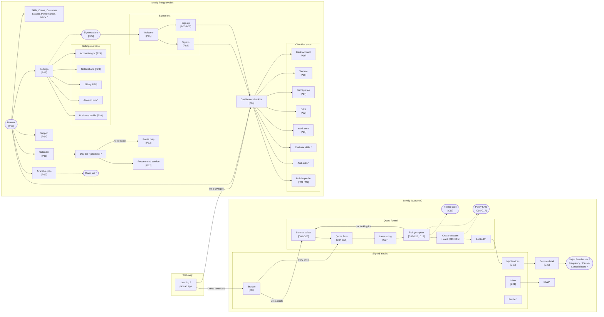

# Mowly: Universal Two-Sided Marketplace PoC

> A lawn care marketplace with two apps that share one monorepo: **Mowly**, where homeowners get an
> instant quote and book recurring lawn services, and **Mowly Pro**, where lawn care professionals
> claim jobs, plan their routes and get paid. Both run in the iOS simulator and, from the same
> source, in the browser behind one landing page. Portfolio piece and architecture study.

## Screen map

Every screen in the PoC and how you get there. Codes in brackets are the reference screenshots
(`C` customer, `P` pro); `*` marks an invented screen with no screenshot. Dashed boxes are modals
or sheets. The landing page exists only on web; the native apps open straight into their app.
Settings also opens the checklist screens for Damage Fee, Tax Info, Bank Info, Starting Point and
Location Services; those edges are left out to keep the map readable.



## Code guidelines

- JSDoc on every exported function, component, hook and type
- One short comment at the top of every file saying what it is for. Inside the file, comment only
  what the name cannot say. Prefer no comment over an obvious one
- Commits are made by the repo owner. Never add `Co-Authored-By` or any other agent attribution to
  a commit message

## Tech stack

The stack is the one in `sagits/repairs` (https://github.com/sagits/repairs), a monorepo with a
client and a pro app on the same versions, already proven on this machine: its `DECISIONS.md`
records `pod install` and the full `xcodebuild` running clean on Xcode 27 with SDK 57. Use these
versions exactly. Do not upgrade, and do not go looking for newer ones.

| Piece | Choice and version | Why |
|---|---|---|
| Apps | **Expo** `57.0.26` + **Expo Router** `~57.0.24` (React Native `0.86.3`, React `19.2.3`) | One codebase per app for iOS and web; file tree is the route tree |
| Language | **TypeScript** `~6.0.3`, strict | |
| UI | **React Native core components** (`View`, `Text`, `Pressable`, `TextInput`, `ScrollView`, `FlatList`, `Modal`, `Switch`, `ActivityIndicator`, `Image`), styled with **NativeWind** `^4.2.7` + **Tailwind** `^3.4.19`, tokens in `packages/ui/tokens.js` | Same stack as repairs. Tailwind classes compile to RN styles and to CSS. No component library |
| Server state | **TanStack Query** `^5.104.0` over the mock API in `packages/api` | Caching, loading and refetch work the way they would against a real backend |
| Local state | **Zustand** `^5.0.15`, one store per domain, in `packages/stores` | Session, onboarding progress, quote-in-progress, anything the mock API does not own |
| Forms | **React Hook Form** `^7.89.0` + **@hookform/resolvers** `^5.9.1` + **Zod** `^4.6.5` | The funnel and the pro onboarding are mostly forms; schemas live in `packages/types` |
| Persistence | `@react-native-async-storage/async-storage` `2.2.0` (the version SDK 57 bundles) | Only if a store needs to survive a reload |
| Web | React Native Web `^0.21.3`, `web.bundler = "metro"`, `web.output = "static"` | Static export makes deep links work on any static host |
| Repo | **Turborepo** `^2.6.1` + **pnpm** `12.3.4`, Node `>=22.13` | Two apps, one set of shared packages |
| Tests | **Jest** `~29.7.0` + `jest-expo` `~57.0.5` + React Native Testing Library `^14.0.1` for stores, API, forms and screens; **Maestro** flows for each ticket's main path | TDD where the logic lives, e2e where the user is |

Add packages with `npx expo install` so Expo picks the versions SDK 57 expects. Anything the table
does not list and repairs does not use is a decision for `DECISIONS.md`.

Mock data only. No backend, no auth, no real API, no payments. Every async call resolves after an
artificial delay.

### How TanStack Query and Zustand split the work

All reads and writes go through TanStack Query hooks in `packages/api`, which call async mock
resolvers. Writes (book a service, claim a job, save a profile) update the in-memory mock database
inside `packages/mocks`, then invalidate the matching queries, so the next read returns the new
data the way a real API would. Zustand holds only client state: the signed-in user, the quote being
built in the funnel, onboarding checklist progress, UI flags. Screens never read mock data directly.

### UI components

Every screen is built from React Native core components styled with NativeWind classes, the same
way repairs does it. There is no component library. Shared building blocks live in `packages/ui`
and are written once: `Button` (filled, outline, orange, disabled, loading), `TextField`,
`Select` (opens a bottom sheet), `Checkbox`, `Radio`, `Toggle` (wraps `Switch`), `BottomSheet`
(wraps `Modal`), `ConfirmDialog`, `Accordion`, `ListRow`, `Card`, `Badge`, `Skeleton`, `Spinner`,
`Toast`, `TabBar`. repairs already has `ConfirmDialog`, `FormField`, `HeaderBand`, `Screen` and
`StatusPill` in its `packages/ui`; start from those. Its `BackButton` is a hand-drawn chevron, so
it is not used here (see the back navigation rule below). App-level pieces
(plan row, job card, checklist row, settings row, sticky cost footer) are compositions of these.
Colors come only from the Design tokens below. No hardcoded colors in screens.

**Icons.** repairs draws its few icons by hand and ships no icon font. Mowly needs dozens (tab bar,
drawer, list rows), so add `@expo/vector-icons` with `npx expo install` (it ships with Expo, no
native setup) and use one set throughout, Ionicons first. Record the deviation in `DECISIONS.md`.

**Back navigation uses the platform's own back button.** Pushed screens use the Expo Router
`Stack` native header, so iOS shows its native chevron (and the swipe-back gesture) and the web
shows React Navigation's back arrow. Tint it with `primary` and keep the screen title centered and
green, as in the screenshots. Never render the word "Back" as the button: the real app and the
screenshots (`P09`, `P16`-`P24`) and the HTML prototype all show a text "Back", and this rule
overrides them. The customer funnel's back arrow (`C13`) and the signed-in detail header (`C20`)
follow the same rule.

### Start from the repairs template

Ticket 01 copies `sagits/repairs` into this repo and strips it down, instead of scaffolding from
zero. Clone it, copy the files over, and do not keep its git history.

- **Keep:** root `package.json`, `pnpm-workspace.yaml`, `turbo.json`, `eslint.config.js`,
  `.gitignore`, `packages/config` (tsconfig base, Tailwind preset), each app's `app.json` shape,
  `babel.config.js`, `metro.config.js`, `tailwind.config.js`, `global.css`, `nativewind-env.d.ts`,
  `tsconfig.json`, `app/_layout.tsx` and `app/+html.tsx`, the Jest setup, the `packages/api`
  query client (`queryClient.ts`) and its hook pattern, the `packages/stores` pattern,
  `packages/features` as the home for screens shared by both apps, and the `packages/ui`
  components listed above
- **Drop the write overlay** (`overlay.ts`, `useLocalJobs`). repairs needs it because DummyJSON
  does not persist writes; Mowly's mock database does, so a write updates the mock and invalidates
  the query, as described above
- **Remove:** `apps/both`, `scripts/check-app-parity.mjs` (repairs runs one app with a role lock;
  Mowly and Mowly Pro are different apps), every Detox file (`.detoxrc.js`, `e2e/`,
  `scripts/e2e-test.sh`, the `detox` dependency and the `e2e:*` scripts), the DummyJSON client in
  `packages/api` (Mowly runs on local mocks), and every repairs screen, type, fixture and test
  that belongs to its domain
- **Rename:** `@repairs/*` to `@mowly/*`, `apps/client` to `apps/customer`, bundle ids and names
  per the Naming table
- **Add:** `packages/mocks`, the Maestro setup, the landing page and the Mowly tokens
- Read repairs' `DECISIONS.md` before changing any config. It explains why each setting is there,
  including the Xcode 27 simulator note under Environment
- Done means: both apps boot to an empty tab or drawer shell on iOS and web, `pnpm test`,
  `pnpm typecheck` and `pnpm build:web` pass, and `grep -ri repairs` finds nothing outside
  `DECISIONS.md`

### Monorepo structure

```
apps/
  customer/         Mowly: homeowner app (iOS + web, served at /customer on web)
  pro/              Mowly Pro: provider app (iOS + web, served at /pro on web)
  landing/          static web page at / that lets the visitor pick an app
packages/
  ui/               tokens and shared React Native components
  features/         screens and flows used by both apps, if any
  api/              TanStack Query hooks and query keys, one file per domain
  stores/           Zustand stores
  mocks/            seed data, in-memory mock database, delayed resolvers
  types/            domain types and Zod schemas (Service, Plan, Booking, Job, Pro, Customer)
  config/           shared tsconfig, eslint, NativeWind/Tailwind preset
```

The test for `packages/` vs `apps/`: would the other app want it too? A job is a booking seen from
the pro side, so both live in `packages/types` and `packages/mocks`. Screens, navigation and
app-only stores stay in their app.

**Build targets**
- Simulator: `pnpm dev:customer`, `pnpm dev:pro`
- Web: `pnpm build:web` exports both apps (each with its own base URL, `/customer` and `/pro`),
  copies the landing page to the root, and writes one static `dist/`

---

## Overview

**Mowly (customer).** A homeowner picks a service, enters their address, watches the app "size"
their lawn, picks a plan frequency and a start date, creates an account and books. After booking
they land in the app: browse more services, see upcoming services, manage one (skip, reschedule,
change frequency, pause, cancel) and message their pro.

**Mowly Pro (provider).** A lawn pro finishes an onboarding checklist (profile, skills, work area,
GPS, damage fee, tax info, bank), browses available jobs on a map, claims them, sees them on a
calendar, follows an optimized route for the day, recommends extra services to a customer, and
manages their settings.

Both apps boot signed in as their demo user. There is no real sign in. Signing out returns to the
pro welcome screen, and Log In with any input signs back in.

### Naming

| Where | Customer | Pro |
|---|---|---|
| Repo / root package | `mowly` | |
| App folder / package | `apps/customer` / `@mowly/customer` | `apps/pro` / `@mowly/pro` |
| `app.json` → `name` | `Mowly` | `Mowly Pro` |
| `app.json` → `slug` | `mowly` | `mowly-pro` |
| Bundle id | `com.renatoprobst.mowly` | `com.renatoprobst.mowlypro` |
| Header wordmark | `Mowly` | `Mowly` + "for lawn care professionals" |
| Web path / `<title>` | `/customer` / `Mowly` | `/pro` / `Mowly Pro` |

Nothing anywhere carries the real company's name, logo, illustrations or photos. The company is
named only in the README, in one paragraph saying this is a UI and architecture study built for a
portfolio, with no affiliation or endorsement. Copy that names the brand in the screenshots
("Get started with LawnStarter!", "Send Message to LawnStarter", "LawnStarter for Providers -
v5.330.0") uses Mowly instead. Illustrations are replaced by icon-set glyphs or emoji; photos by
free stock images downloaded into the repo.

The web build is `noindex`: a `<meta name="robots" content="noindex">` on every page and a
`robots.txt` that disallows everything.

### Layout fidelity

Match the reference screenshots: spacing, type scale, colors, icons, copy, empty states. Where a
control is expensive to copy (maps, native date picker, address autocomplete, card fields, Stripe
widgets), ship a simpler version built from the same design system. Never fall back to unstyled
defaults.

### Seed data

Dates are relative to today, so the demo never looks stale. "Day 0" is today.

**Customer app** (demo user: Renato Probst, `1820 Maple Ridge Drive, Austin, TX 78704`):
- **Services catalog**, 11 entries in this order: Mowing, Leaf Removal, Flower Bed Weeding, Bush
  Trimming, Pool Cleaning, Lawn Treatment, Mosquito Prevention, Aeration, Aeration & Overseeding,
  Cleanup, Weeding. Each has a "What's included" sentence, a stock photo and a list of frequencies
  with a price per frequency. Mowing: Weekly $57 (recommended), Every 2 Weeks $60, Monthly $60.
  Recurring services (Lawn Treatment, Mosquito Prevention, Pool Cleaning) offer Monthly and Every 2
  Weeks. The rest offer One-time and Monthly
- **2 booked services**: Lawn Mowing, Monthly, next service day +5, $53.00, pro "Greenleaf Lawn
  Co."; Lawn Treatment, Recurring, next service day +10, pro "Greenleaf Lawn Co."
- **1 inbox thread** with Greenleaf Lawn Co. about Lawn Mowing, 3 messages, last one from the pro
- **Address autocomplete**: a fixed list of 6 Austin addresses that filters as the user types
- **Lot size**: derived from the address with a deterministic hash, so the same address always
  gets the same price

**Pro app** (demo user: Mike Sullivan, business "Sullivan Lawn Care", Austin, TX, crew of 2):
- **Onboarding checklist**: "Build a profile" and "Add your skills" done, the other 6 items open,
  so the dashboard shows progress
- **10 available jobs** across the next 5 days, Austin addresses, mixed services (Lawn mowing
  Weekly / Bi-Weekly, Leaf Removal, Bush Trimming), prices $29.99 to $40.99, yard sizes, "N dates
  available for pick up", distance from the previous job on route
- **12 claimed jobs** spread over the current and next month, so the calendar has counts on
  several days, including 3 today
- **Today's route**: the 3 jobs for today, in order, with distance from the starting point and from
  the previous job
- **Billing**: account balance $0.00, no activity (matches `20`)

Empty states stay implemented for every list and are reachable with `SEED=false`.

### Loading states

Mock resolvers wait 600 to 1200 ms. Lists and cards load behind skeletons. Full screen loads and
button actions use a spinner, which in the real apps is a small thin gray iOS-style spinner
(`08`, customer `12`, pro welcome `01` before the buttons appear). Primary buttons show their
spinner inside a disabled gray button (`12`). The lawn sizing screen (customer `07`) is its own
loading state and must animate.

---

## Reference screenshots

**The apps must be built to match these screenshots.** They are the specification for layout. Each
feature below lists the screenshot numbers it maps to, and those numbers are the source of truth.
Where this text and a screenshot disagree, follow the screenshot and record the conflict in
`DECISIONS.md`.

Two folders, numbered in flow order. Screenshot numbers in this PRD are prefixed with the app:
`C01` is `screenshots/clients-app/01-…`, `P10` is `screenshots/providers-app/10-…`.

Sources, because they differ:
- Frames from screen recordings of the real iOS apps (`.jpg`). These are exact
- Store listing screenshots (`.png`): customer `C18`-`C21` are Android captures of the signed-in
  app; pro `P10`-`P13` are cropped out of marketing frames and are older and lower resolution. Use
  them for structure and content. The iOS frames win on any visual conflict (fonts, header style,
  status bar). The customer signed-in screens are rebuilt in the iOS visual language of `C01`-`C17`

### Customer (`screenshots/clients-app/`)

| # | Screen | Flow | State |
|---|---|---|---|
| C01 | Service select | Quote | Nothing selected, Continue disabled |
| C02 | Service select, scrolled | Quote | Rest of the list |
| C03 | Service select | Quote | Mowing selected, Continue enabled |
| C04 | Quote form | Quote | Filled |
| C05 | Quote form | Quote | Address autocomplete open |
| C06 | Quote form, scrolled | Quote | Consent text and "safe & secure" |
| C07 | Lawn sizing | Quote | Loading (animated ring) |
| C08 | Plan screen | Quote | Loading |
| C09 | Pick your plan | Quote | Weekly selected |
| C10 | Pick your plan, scrolled | Quote | What's included, FAQ link, "not looking for" link |
| C11 | Add promo code | Quote | Modal, empty |
| C12 | Pick your plan | Quote | Continue loading |
| C13 | Create your account | Checkout | Empty |
| C14 | Create your account, scrolled | Checkout | Card section |
| C15 | Create your account, scrolled | Checkout | Terms and policy summary |
| C16 | Policy FAQ | Checkout | Collapsed |
| C17 | Policy FAQ | Checkout | Several expanded |
| C18 | Browse | Signed in | Populated |
| C19 | My Services | Signed in | Populated |
| C20 | Service detail | Signed in | Scheduled |
| C21 | Inbox | Signed in | One thread |

### Pro (`screenshots/providers-app/`)

| # | Screen | Flow | State |
|---|---|---|---|
| P01 | Welcome | Auth | Carousel slide 1 |
| P02 | Sign in | Auth | Empty |
| P03 | Sign up | Auth | Empty |
| P04 | Sign up | Auth | Category picker open |
| P05 | Sign up | Auth | Category picked, core skills shown |
| P06 | Dashboard | Onboarding | Checklist, profile item enabled |
| P07 | Drawer menu | Navigation | Open over dashboard |
| P08 | Build a winning profile | Onboarding | Intro |
| P09 | Build a winning profile | Onboarding | Form |
| P10 | Available jobs | Jobs | Map and job list (store shot) |
| P11 | Calendar | Jobs | Month grid with counts (store shot) |
| P12 | Service quote | Jobs | Recommend a service (store shot) |
| P13 | Route map | Jobs | Today's route (store shot) |
| P14 | Support | Support | |
| P15 | Settings | Settings | List |
| P16 | Business profile | Settings | Form |
| P17 | Damage fee | Settings / Onboarding | Opted in |
| P18 | Tax info | Settings / Onboarding | Form |
| P19 | Connect bank account | Settings / Onboarding | Not linked |
| P20 | Billing | Settings | Empty |
| P21 | Set up your work area | Settings / Onboarding | One starting point |
| P22 | Turn on your GPS | Settings / Onboarding | |
| P23 | Notifications | Settings | All on |
| P24 | Account management | Settings | |
| P25 | Sign out | Settings | Confirm alert |

Not captured, so built from the design system and marked **invented** below: the customer Profile
tab, the customer chat screen, booking confirmation, the pro Skills, Crews, Customer Search,
Performance and Inbox screens, and the pro dashboard after the checklist is done.

---

## Design

Approximate values sampled from the screenshots.

| Token | Value | Source |
|---|---|---|
| `primary` | `#18C058` | CTA buttons, links, selected check (`C03`, `C09`) |
| `primaryHeader` | `#08B460` | Signed-in customer header band (`C18`-`C21`) |
| `primaryTint` | `#DCF4E8` | Selected option background (`C03`, `C09`) |
| `accent` | `#F48C04` | Save buttons on pro settings forms (`P16`) |
| `surfaceMuted` | `#D8D8D8` | Unselected option tiles (`C01`, `C09`) |
| `priceBlock` | `#A0A0A0` | Price cell of unselected plan rows (`C09`) |
| `callout` | `#E0E0E4` | "What's included?" and "Core skills needed" header (`C10`, `P05`) |
| `pageMuted` | `#E8E8EC` | Gray page background (`P20`) |
| `ink` | `#111111` | Customer titles and body text (`C01`, `C04`, `C16`) |
| `inkSoft` | `#222222` | Plan row labels (`C09`) |
| `inkPro` | `#3A3A3A` | Pro titles and list rows (`P06`, `P09`, `P15`, `P20`) |
| `inkProBody` | `#4C4C4C` | Pro supporting text (`P06`) |
| `fee` | `#575757` | "+ $3.99 Trust & Safety Fee" (`C09`) |
| `muted` | `#616161` | Customer subtitles (`C01`, `C04`); `#7A7A7A` on the plan subtitle (`C09`) |
| `legal` | `#888888` | Consent and legal text (`C06`), disabled button label (`C01`) |
| `disabled` | `#9E9E9E` | Locked checklist rows (`P06`) |
| `placeholder` | `#A6A6A6` | Input placeholders (`C04`, `C13`) |
| `link` | `#5779A6` | Inline text links ("Frequently Asked Questions", "terms of service") (`C10`) |
| `danger` | `#FF3B30` (iOS red) | Destructive actions |

- Font: a clean neo-grotesque sans (Inter, falling back to the system font). Exact sizes, weights
  and colors are in Typography below
- Buttons and green text links use uppercase labels (`CONTINUE`, `BOOK NOW`, `SIGN OUT`,
  `ADD A PROMO CODE`)
- Primary buttons: full width, pill shaped (fully rounded), green, white uppercase label. Disabled:
  light gray with gray label (`C01`). Secondary: white with green border and green label (`P01`)
- Inputs: white, 1px light gray border, ~4px radius, label above in small bold text. Focused: green
  border (`C05`)
- Option tiles (`C01`): full width, flat gray, centered label, ~4px radius, tight vertical gap
- Customer quote and checkout: white header with wordmark left, green phone icon right, home icon
  and street address below (`C01`). Sticky footer with "Cost per service", the fee line and the CTA
  (`C09`)
- Pro app: white nav bar with a green centered title, the native back button tinted green (see
  UI components) or a green hamburger (`P15`, `P16`). List rows with a green chevron (`P15`)
- Light theme only

### Typography

Measured on the iOS recording frames (1170px wide, so 3px = 1pt). For each text line the script
measured the ink height (top of the tallest glyph to the bottom of the lowest), turned it into a
font size from the glyphs in the line (cap height ≈ 0.73em, ascender to descender ≈ 0.96em),
estimated the weight from the stroke width (≈ 0.09em regular, 0.12em semibold, 0.14em and up bold)
and took the color from the darkest ink pixel. Expect ±1pt. React Native takes sizes in points, so
these go into Tailwind as px. Which style each text uses is up to the builder, matched against the
screenshots.

Add this to the shared Tailwind preset in `packages/config`. The colors are the Design tokens
above:

```js
// packages/config/tailwind-preset.js  (theme.extend)
colors: {
  primary:       '#18C058', // CTAs, links, selected check, green titles
  primaryHeader: '#08B460', // signed-in customer header band
  primaryTint:   '#DCF4E8', // selected option background
  accent:        '#F48C04', // pro settings Save buttons
  surfaceMuted:  '#D8D8D8', // unselected option tiles
  priceBlock:    '#A0A0A0', // unselected plan row price cell
  callout:       '#E0E0E4', // "What's included?" header
  pageMuted:     '#E8E8EC', // gray page background
  // text
  ink:           '#111111', // customer titles and body
  inkSoft:       '#222222', // plan row labels
  inkPro:        '#3A3A3A', // pro titles and list rows
  inkProBody:    '#4C4C4C', // pro supporting text
  fee:           '#575757', // "+ $3.99 Trust & Safety Fee"
  muted:         '#616161', // subtitles
  legal:         '#888888', // consent text, disabled button label
  disabled:      '#9E9E9E', // locked checklist rows
  placeholder:   '#A6A6A6', // input placeholders
  link:          '#5779A6', // inline text links
  danger:        '#FF3B30', // destructive actions (iOS red)
},
fontFamily: {
  sans: ['Inter', 'System'],
},
fontSize: {
  //            size     line height + weight
  'display':   ['36px', { lineHeight: '40px', fontWeight: '800' }], // P20 "$0.00"
  'title-lg':  ['28px', { lineHeight: '34px', fontWeight: '700' }], // C01, C04, C09 screen titles
  'title-md':  ['26px', { lineHeight: '32px', fontWeight: '700' }], // C13 "Create your account"
  'title-sm':  ['22px', { lineHeight: '28px', fontWeight: '700' }], // P06 "Welcome, Mike", P09 title
  'heading':   ['18px', { lineHeight: '24px', fontWeight: '700' }], // P01 "Your Next Client is a Tap Away"
  'nav':       ['17px', { lineHeight: '22px', fontWeight: '500' }], // P09, P15, P17 nav bar title (green)
  'plan':      ['17px', { lineHeight: '22px', fontWeight: '600' }], // C09 plan row label
  'body-lg':   ['16px', { lineHeight: '24px', fontWeight: '400' }], // C01 subtitle, inputs, P17 body
  'body':      ['14px', { lineHeight: '20px', fontWeight: '400' }], // C01 tiles, P06/P15 rows, C10 bullets
  'label':     ['14px', { lineHeight: '18px', fontWeight: '600' }], // C04, C13 form labels
  'button':    ['14px', { lineHeight: '18px', fontWeight: '700', letterSpacing: '0.06em' }], // CONTINUE, ADD A PROMO CODE (uppercase)
  'caption':   ['13px', { lineHeight: '18px', fontWeight: '400' }], // C09 fee line, P06 "customers served" pill
  'overline':  ['12px', { lineHeight: '16px', fontWeight: '600', letterSpacing: '0.1em' }], // P20 "ACCOUNT BALANCE" (uppercase)
  'label-sm':  ['12px', { lineHeight: '16px', fontWeight: '700' }], // P16 form labels
  'fine':      ['12px', { lineHeight: '16px', fontWeight: '400' }], // C06 consent text
  'micro':     ['9px',  { lineHeight: '12px', fontWeight: '600' }], // P01, P15 version line
},
```

## Navigation

**Customer.** Two stacks:
1. **Quote funnel** (modal stack over everything): Service select → Quote form → Lawn sizing → Pick
   your plan → Create your account → booking confirmation. Promo code and Policy FAQ open as modals
2. **Signed-in tabs**: Browse, Service, Inbox, Profile, with the icons in `C18` (storefront, calendar
   check, inbox tray, person). Active tab is green with label; inactive is gray with label. The
   green header band carries the screen title, a gift icon and the address switcher

On web at `md` and above, the tab bar becomes a left sidebar and content is centered with a max
width. The funnel is a single centered column at every width.

**Pro.** A drawer (`P07`) with the user's name in green capitals at the top, then: Dashboard,
Available Jobs, Skills and Services, Calendar, Crews, Inbox, Customer Search, Performance, Support,
Settings (with a green badge counting open settings items). Active row: green icon, others gray.
Screens inside a section push onto a native stack with the native back button. On web at `md` and above the
drawer is a permanent left sidebar.

**Landing (web only).** `/` is a single page in Mowly's design system with two large cards side by
side (stacked on phones): "I need lawn care" opens `/customer`, "I'm a lawn pro" opens `/pro`. One
line under the cards says the apps run on mock data. Each app has a small "Switch app" link in its
web header back to `/`. The native apps never show the landing or the switch link.

---

## Features: customer (Mowly)

### Service select → `C01`, `C02`, `C03`

Header as in Design. Title "Get started with Mowly!", subtitle "What are you looking for?". The 11
services as gray tiles. Tapping one selects it (green tint, green outline check on the right) and
deselects any other. Continue stays disabled until one is selected.

### Quote form → `C04`, `C05`, `C06`

Title "Let's get your {Service} quote", subtitle "We need some details to provide a price
estimate." Fields: Name*, Address* with autocomplete (filters the seeded address list, dropdown as
in `C05`), Apartment/Suite Number, Phone Number*. Consent paragraph with "terms of service" and
"privacy policy" links (inert), a lock icon and "Your information is safe & secure". Validation with
Zod: name required, address must be picked from the list, phone 10 digits. Prefilled with the demo
user's name, address and phone so the demo is one tap.

**Simplification:** the address autocomplete is the fixed seeded list, no places API.

### Lawn sizing → `C07`

Full screen, no header. A circular aerial photo of a neighborhood (stock image) with a green
progress ring drawing around it, "We're sizing your lawn with satellite precision!", and "Join
**49 neighbors** in {ZIP} who've booked Mowly" with the number in green. Lasts about 3 seconds,
then goes to the plan screen. The neighbor count comes from the mock, per ZIP.

### Pick your plan → `C08`, `C09`, `C10`, `C11`, `C12`

`C08` is the loading state. Title "Pick your {Service} plan", subtitle "Select the frequency for
your following services, you can always change this later." Plan rows: label on the left, price
block on the right ("$57" big, "per service" small). Selected row: green tint and green price block.
A "Recommended" green tab sits above the recommended row. Preferred start date field (opens a date
sheet, defaults to the next available weekday). "ADD A PROMO CODE" green link opens `C11` (code
input, Apply disabled until text; any code shows "Code applied" and takes $5 off). "What's
included?" callout with a bulb icon and a bullet. "Have additional questions? Read our Frequently
Asked Questions" (opens the Policy FAQ, `C16`). "I'm not looking for {Service}" link goes back to
service select. Sticky footer: "Cost per service" and price, "+ $3.99 Trust & Safety Fee", CONTINUE.
Continue shows the in-button spinner (`C12`).

**Simplification:** the start date picker is a sheet with the next 14 days as a list, built from
the design system, not the native date picker.

### Create your account and book → `C13`, `C14`, `C15`, `C16`, `C17`

Back arrow and "Create your account". Full Name* (first, last), Email address*. "Inspect First, Pay
Later Promise" card with a green card icon and its copy. "Card" section with card number,
expiration and security code fields and the "By providing your card information…" text. Terms
checkbox with a "Terms of Service" link. A policy summary card with a pin icon, two bullets, "Our
terms include:" and three bullets with bold fragments (`C15`). FAQ link opens the Policy FAQ
(`C16`, `C17`): large title "Frequent Questions about our Policies", seven accordion rows, OK button.
Sticky footer as before, CTA "BOOK NOW", enabled only when the form is valid and the box is checked.

**Simplification:** the card fields are plain inputs from the design system, prefilled with
`4242 4242 4242 4242`, `12 / 34`, `123` and marked "Demo card, nothing is charged". No Stripe
element, no real card is ever accepted: the schema only accepts that one test number.

Book Now shows the in-button spinner, writes the booking to the mock database, and lands on a
booking confirmation (**invented**: green check, "You're booked!", service, plan, first date, "Go to
my services") which resets the funnel and opens the Service tab with the new booking on top.

### Browse → `C18`

Green header band: "Browse", gift icon, home icon + address with a chevron (address switcher sheet
with the demo user's one address and "Add address", inert). "Recommended for you": a card carousel
with page dots (3 cards: Take a break / leaf removal, Keep it green / lawn treatment, Bite-free
summer / mosquito prevention), each with a GET A QUOTE pill that opens the funnel for that service.
"Services to explore": rows with a photo on the left, title, one line, and a VIEW PRICE outline
pill that opens the funnel with that service preselected (skips service select).

### My Services → `C19`

Header "My Services". Cards with a green left border: service name, "Scheduled" green chip, calendar
icon + "Next service {date}", clock icon + frequency, chevron. Empty state: "No services yet" and a
"Get a quote" button.

### Service detail → `C20`

Green header: back button, service name, address, "?" help icon. "Upcoming Service" with the
"Scheduled" chip, date (frequency), price per service, pro name. "What's included?" paragraph.
Action rows with chevrons: Skip, One-time reschedule, Change frequency, Pause for the season,
Cancel. Each opens a sheet (**invented**, design-system only): Skip and Cancel confirm and update
the booking; Reschedule reuses the date sheet; Change frequency reuses the plan rows; Pause sets
status "Paused" until a chosen month.

### Inbox → `C21`

Header "Inbox". Thread rows: initials avatar on a green tint ("GL"), pro name, service, last message
preview, date, chevron. Tapping opens a chat screen (**invented**: bubbles, input, send; sending
appends the message and a canned pro reply arrives after 2 seconds).

### Profile (**invented**)

Built like the pro Settings list (`P15`): name and email at the top, rows for Addresses, Payment
methods (the demo card), Notifications, Help, and a "Reset demo" row that clears the mock database
back to the seed. The real app's Profile tab was not captured.

---

## Features: pro (Mowly Pro)

### Welcome, sign in, sign up → `P01`, `P02`, `P03`, `P04`, `P05`

Shown only after signing out. Wordmark "Mowly" with "for lawn care professionals" and the version
line, a 3-slide carousel (slide 1 is `P01`: illustration replaced by a large house emoji or icon,
"Your Next Client is a Tap Away" and its copy; slides 2 and 3 **invented**: "Plan your day" and "Get
paid weekly"), LOG IN (filled) and SIGN UP (outline).

Sign in (`P02`): Email, Password with eye toggle, "I NEED HELP ACCESSING MY ACCOUNT" link (inert),
SIGN IN. Any non-empty input signs in as the demo user.

Sign up (`P03`-`P05`): "Sign up to become a top Mowly partner", zip code, email, phone, category
picker (Basic Lawn Care, Basic Pool Care). Picking a category shows the "Core skills needed"
callout with its bullet list. Consent text and "Consent is not a condition of service." NEXT
validates with Zod and then signs in as the demo user (the real multi-step registration is out of
scope).

**Simplification:** the category picker is a design-system bottom sheet, not the iOS wheel.

### Dashboard → `P06`

Hamburger, a pill with "1291 customers served in Austin, TX", "Welcome, Mike", "Complete your
account (Profile first, then payments):". Two groups, "Build a winning profile" (Build a profile,
Add your skills, Evaluate your skills, Add your work area) and "Set up to get paid" (Turn on your
GPS, Accept damage fee, Provide tax info, Connect your bank account). Rows unlock in order: done
rows get a green check, the next open row is enabled with a green chevron, later rows are gray.
Each row opens its screen; finishing it marks the row done and returns here.

When all 8 are done (**invented**): the checklist collapses into a "You're all set" card, and the
dashboard shows "Today's route" (the route card from `P13`) and "Available jobs near you" (top 3
job cards from `P10`) with links to both screens.

### Build a winning profile → `P08`, `P09`

Intro (`P08`): illustration replaced by an icon, title, copy, CONTINUE. Form (`P09`): back button + "Build
a profile" title bar, "Build a winning profile", copy, Business name, Year founded, Number of
crew(s), "Upload a clear headshot photo" with a gray circular camera button, CONTINUE.

**Simplification:** the headshot button opens a sheet with 4 bundled sample avatars instead of the
camera roll, so the app needs no native module.

### Remaining checklist screens

- **Add your skills** (**invented**): the category's core skills as toggle rows, using the callout
  style from `P05`
- **Evaluate your skills** (**invented**): three yes/no equipment questions (own mower, trimmer,
  blower) as rows with switches
- **Add your work area** → `P21`
- **Turn on your GPS** → `P22`: icon, "Enable your GPS", copy, "Frequently Asked Questions" with 3
  accordion rows, ENABLE GPS (marks the row done, no permission prompt)
- **Accept damage fee** → `P17`
- **Provide tax info** → `P18`
- **Connect your bank account** → `P19`

### Available jobs → `P10`

Title "Available Jobs" with back. Day filter strip: "All" plus the next 5 days, selected cell
green. A map area with green price pins; the selected pin is filled green. "‹ 1 of 10 jobs ›" pager
synced with the selected pin. Job card: address (two lines), yard size, "**3 dates available** for
pick up" with the count in green, then one row per available date: service and frequency, price,
date in orange, distance from the previous job on route. Tapping a date row opens a claim sheet
(**invented**): job summary and CLAIM JOB. Claiming removes it from available, adds it to the
calendar and today's route if it is today.

**Simplification:** the map is a static illustrated city map image bundled in the repo with pins
positioned from fixed coordinates in the seed. No map SDK.

### Calendar → `P11`

Hamburger, "Calendar". Month grid for the current and next month, weekday header, each day a small
gray date tab with the claimed job count in blue below it; today outlined in green. Tapping a day
with jobs opens a day list (**invented**: job rows with address, service, price; "View route" for
today). Each job row opens a job detail (**invented**) with customer address, service, frequency,
price, notes, and "Recommend a service".

### Recommend a service → `P12`

Back button + "Service Quote". "Which service would you like to recommend?" and a 2-column grid of
outlined tiles: Bush Trimming, Cleanup, Tree Trimming, Bed Weeding, Mulching, Other. Picking one
asks for a price and a note, then sends it (shows a toast "Recommendation sent").

### Route map → `P13`

Back button + "Route Map". Map image with a blue route line and numbered pins. A green-tint banner
"Starting Date: {today}". One row per stop: numbered pin, address (bold, two lines), service and
frequency, distance from starting point or previous job.

**Simplification:** same static map image as Available Jobs, route line drawn with SVG over it.

### Support → `P14`

Hamburger + "Support". Three cards: "Need help with something?" with "Send Message to Mowly",
"Need to talk to somebody?" (Mondays through Sundays copy), "Have a question about the Mowly
platform?" with "Visit the Knowledge Base". Buttons are inert or show a toast.

### Settings → `P15` to `P25`

List (`P15`): Business Profile (green badge "1" while incomplete), Account Info, Damage Fee, Tax
Info, Bank Info, Billing, Starting Point (original service area), Location Services, Notification
Preferences, Account Management, the version line "Mowly Pro - v1.0.0", and SIGN OUT.

- **Business Profile** (`P16`): Profile Photo and Truck Photo circles, "NEW!" hint, Company name,
  Office phone number, Business address with a pin icon, "Help customers get to know you" textarea
  with a `0/250` counter, orange SAVE
- **Account Info**: first name, last name, mobile phone, business email, orange SAVE. Built in the
  `P16` form style (the captured frame is not used because it shows personal data)
- **Damage Fee** (`P17`): green title "You're opted into Mowly's damage fee policy." and the two
  paragraphs
- **Tax Info** (`P18`): "Provide tax info", "Tax info" with a "Powered by stripe"-style badge
  replaced by "Secured", Legal Entity Type select, Legal Name, date of birth, Legal Address. **The
  SSN field is shown disabled with "Not collected in this demo"**. No real tax data is ever entered
- **Bank Info** (`P19`): explanatory copy, LINK BANK ACCOUNT (shows a spinner, then "Demo Bank ••••
  6789 linked"), "I don't have a bank account" link
- **Billing** (`P20`): "ACCOUNT BALANCE $0.00" card on a gray page, "Activity" with a Filter
  button, segmented "Since last payout" / "All time", "No billing activity yet." Claimed jobs that
  are in the past add rows here (**invented** row design)
- **Starting Point** (`P21`): "Set your work area", copy, "Main Crew", "General work days Mon-Sun"
  with a pencil, radio "One starting point for all work days" with the address and a pencil,
  radio "Different starting points by work day", green SAVE
- **Location Services** (`P22`)
- **Notification Preferences** (`P23`): "Job Notifications" and "Customer Messages", each with
  Email, Text Message, Push Notification switches
- **Account Management** (`P24`): "Account Deletion" row, opens a confirm alert, Delete is inert
- **Sign out** (`P25`): native-style alert "Are you sure you want to sign out?" with Cancel and Sign
  out. Sign out goes to Welcome (`P01`)

### Drawer items with no screenshot

Skills and Services, Crews, Customer Search, Performance and Inbox open simple **invented**
screens in the design system: a title, one seeded list each (skills, crew members, customer search
field over past customers, three performance stats, message threads). Keep them small. They exist
so no drawer row is dead.

---

## Environment

- Simulator: **`iPhone 16`** (verified with `xcrun simctl list devices available`). Xcode 27.1 is
  installed
- **Xcode 27 ships no launchable `Simulator.app`** (repairs' `DECISIONS.md` has the details). Boot
  the device with `xcrun simctl boot "iPhone 16"` before installing the app or running Maestro.
  Do not try `open -a Simulator` and do not run `xcode-select`; neither is the problem
- The Expo SDK is fixed at 57 (see Tech stack). It already builds on this machine
- Everything runs locally. No EAS, and never run a command that needs an Expo, Apple or Google
  login. If a step seems to need one, it is the wrong step
- Native builds (`expo prebuild`, `expo run:ios`) take 10 to 20 minutes. Run them in the
  background and read the log. A shell timeout is not a build failure
- The apps stay free of custom native modules. Android is out of scope for the e2e runs

### End-to-end tests with Maestro

- Maestro is not installed on this machine yet. Install it with Homebrew
  (`brew tap mobile-dev-inc/tap && brew install mobile-dev-inc/tap/maestro`); it needs Java 17 or
  newer, also from Homebrew if missing. No Maestro Cloud account, no login
- **One flow per ticket, covering that ticket's main path.** Maestro tests what the user can do,
  not how it looks: tap through the flow and assert the outcome (the booking appears in My
  Services, the claimed job is on the calendar, the checklist row turns done). Do not assert
  skeletons, spinners, colors, spacing or copy that is only decoration. Layout is covered by the
  fidelity check, loading states by Jest
- Flows are YAML files in `apps/<app>/.maestro/`, named after the ticket (`quote-funnel.yaml`,
  `my-services.yaml`, `checklist.yaml`, `available-jobs.yaml`...), plus shared subflows in
  `.maestro/common/` (launch with seed, sign in, open drawer item)
- Flows target the simulator build of each app, installed once with `expo run:ios` (Debug,
  unsigned, simulator SDK). Use `appId` from the naming table. A JS change only needs Metro
  running; rebuild only when something native changes
- Select elements by `id` (`testID` on the component), never by screen coordinates. Text matching
  only where the text itself is what the test checks
- Every flow starts with `launchApp` and `clearState: true`, so each runs on fresh seed data
- `pnpm e2e` runs all flows for both apps and exits non-zero on any failure. `maestro test
  --format junit` writes a report to `apps/<app>/.maestro/report.xml` for the README

### Working autonomously

This PRD is handed to an agent that builds the whole thing. Nobody is available to answer
questions mid-build.

- **Do not ask questions.** Where the PRD leaves something open, pick the sensible default, write
  it in `DECISIONS.md` with the reason, and keep going
- **Close the loop per feature:** implement → run its tests → fidelity check → fix → next feature.
  Never batch testing at the end
- **Fidelity check:** after a screen works, screenshot it in the simulator and put it next to its
  reference. List every visible difference (spacing, color, copy, icon, missing element). Fix it,
  or record it in `DECISIONS.md` as a screenshot simplification
- **Screens marked invented** have no screenshot. Their layout reference is the HTML prototype in
  `poc/prototype/index.html` (open it in a browser and pick the screen from the index). Match its
  structure and content, rebuilt with the shared components. The prototype is a sketch: where it
  disagrees with this PRD or with the Design tokens, the PRD wins, and its text "Back" buttons are
  replaced by the native back button
- If something cannot be done, finish everything else first, then report what is left and why

### Two apps in parallel

After ticket 01 (template, tokens, shared components, mocks, API and both app shells), the work
splits in two tracks that run at the same time, each in its own session and its own git worktree:

- **Customer track:** every ticket under `apps/customer` (funnel, Browse, My Services, Service
  detail, Inbox, Profile)
- **Pro track:** every ticket under `apps/pro` (dashboard and checklist, jobs, calendar, route,
  settings, auth)

Rules that keep the tracks from colliding:
- Ticket 01 puts everything both apps need in `packages/` up front: all shared components, all
  domain types and schemas, the full seed and every mock resolver. Tracks then mostly read
  `packages/`, not write it
- A track that needs a change in `packages/` makes it only if it is additive (a new component, a
  new resolver, a new optional field), and lists it in its own `PACKAGES-CHANGES.md`. It never
  edits or renames something the other track may be using
- Each track commits to its own branch. A final integration ticket merges both branches, resolves
  any `packages/` overlap, runs every Jest suite and both apps' Maestro flows, then does the web
  verification
- `DECISIONS.md` entries are prefixed with the track (`[customer]`, `[pro]`) so the merge does not
  lose either side's reasoning

## Running it

| What | Command |
|---|---|
| Customer app in the simulator | `pnpm dev:customer` |
| Pro app in the simulator | `pnpm dev:pro` |
| Simulator builds for e2e | `pnpm e2e:build` (`expo run:ios` for both apps, in the background) |
| Maestro flows | `pnpm e2e` (both apps), `pnpm e2e:customer`, `pnpm e2e:pro` |
| Unit and integration tests | `pnpm test` |
| Web build | `pnpm build:web` (landing + both apps into `dist/`) |
| Web smoke check | `npx serve dist` |

### Web verification (final step)

A clean `pnpm build:web` only proves it compiled. Serve `dist/` and open it in a browser:

- `/` shows the landing with both cards, and each card opens its app
- `/customer` opens Browse with the seeded services; `/pro` opens the dashboard with the checklist
- Deep links load directly: `/customer/services`, `/pro/calendar`, `/pro/settings/billing`
- The quote funnel and the pro forms work with mouse and keyboard
- At desktop width the customer tab bar and the pro drawer become left sidebars, content centered
- The console has no errors and no React Native Web warnings about unsupported props

Record every `.web.tsx` file that ends up existing, and why, in the README. Deployment to Vercel is
done manually afterwards.

## Scope

**Build first:**
1. Ticket 01, alone: the repairs template stripped down, tokens, shared components, mock database
   and API, both app shells, landing page

Then both tracks at the same time:

| Customer track | Pro track |
|---|---|
| 2. Quote funnel end to end (`C01`-`C17`) and the booking landing in My Services | 2. Dashboard checklist with all 8 steps (`P06`, `P08`, `P09`, `P17`-`P19`, `P21`, `P22`) |
| 3. Browse, My Services, Service detail, Inbox list (`C18`-`C21`) | 3. Available Jobs, claim, Calendar, Route map (`P10`, `P11`, `P13`) |
| | 4. Settings and sign out (`P15`-`P25`), welcome and sign in (`P01`, `P02`) |

Last: the integration ticket (merge both tracks, all tests, web verification).

**After that:** pro sign up (`P03`-`P05`), Recommend a service (`P12`), Support (`P14`), the
invented drawer screens, customer chat and Profile, service management sheets, the post-checklist
dashboard, and polish.

**Stretch, web only:** both apps are served from the same origin, so they can share one persisted
mock database. A booking made in `/customer` then shows up as an available job in `/pro`. Do this
only after everything above is done, and document how in the README.

**Demo flow that has to work start to finish:** in Mowly, open Browse → View price on Leaf Removal →
quote → sizing → pick a plan → create account → Book Now → see the new booking in My Services and
open it; then in Mowly Pro, finish the "Accept damage fee" checklist step, claim an available job,
and find it on the calendar and on today's route.
